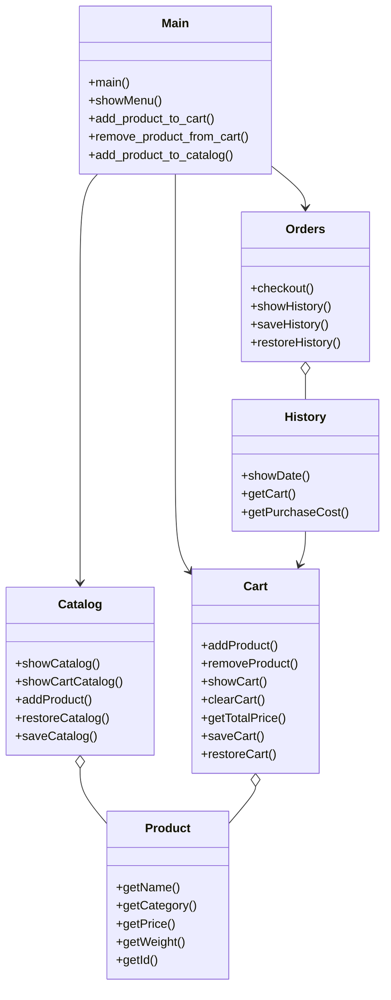
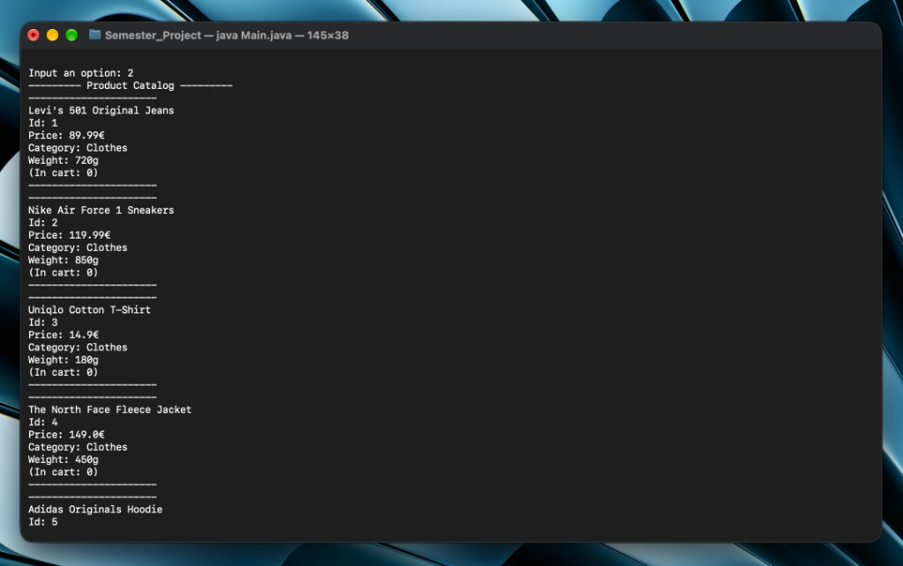
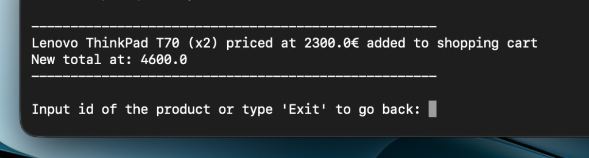
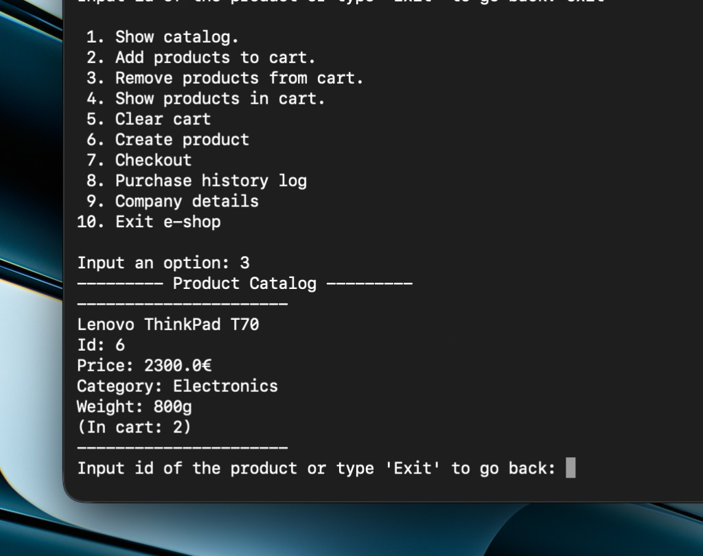
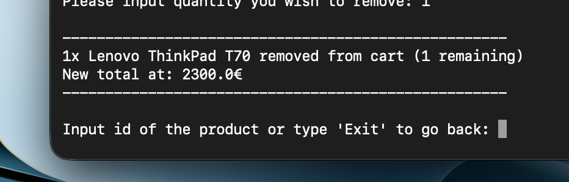
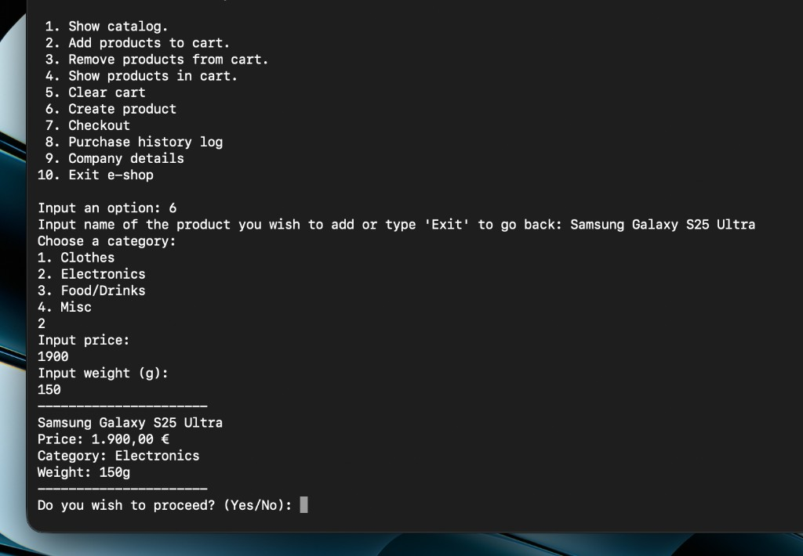
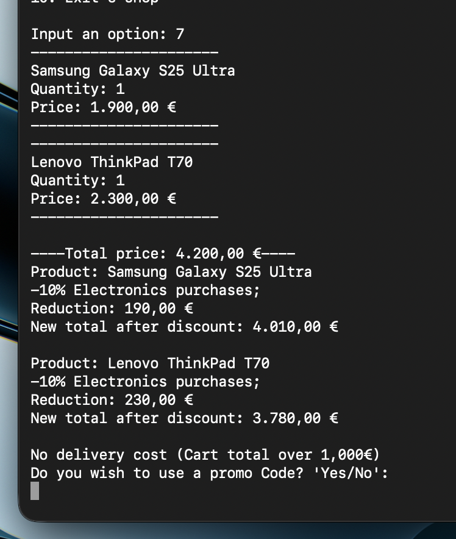
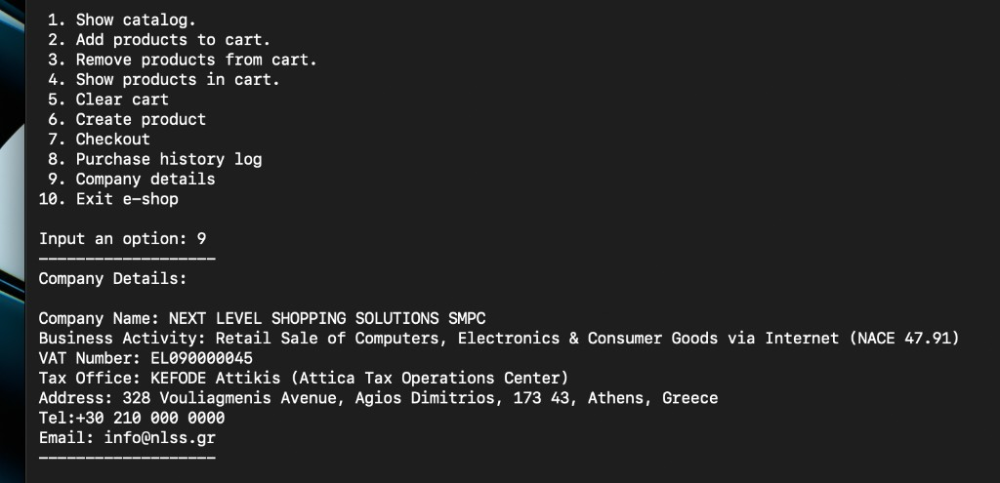

<p align="center">
  
</p>

<p align="center">
  Εφαρμογή κονσόλας για κατάλογο προϊόντων, καλάθι, εκπτώσεις, ολοκλήρωση αγοράς και ιστορικό.<br>
  Σπουδαστής: <strong>TSOUTAS KONSTANTINOS</strong>
</p>

<p align="center">
  <a href="docs/Paradeigma_Ektelesis_NLSS.pdf"><strong>Παράδειγμα εκτέλεσης (PDF)</strong></a>
  &nbsp;·&nbsp; βήμα-βήμα, με στιγμιότυπα και τις συναρτήσεις κάθε οθόνης
</p>

---

Η **NLSS E-Shop** (Next Level Shopping Solutions) είναι εξαμηνιαία εργασία σε Java. Ο χρήστης κινείται από ένα μενού δέκα επιλογών: βλέπει τον κατάλογο, προσθέτει και αφαιρεί προϊόντα από το καλάθι, δημιουργεί νέο προϊόν, ολοκληρώνει αγορά με έκπτωση κατηγορίας και κωδικό προσφοράς, και συμβουλεύεται το ιστορικό. Κατάλογος, καλάθι και ιστορικό γράφονται σε αρχεία κειμένου και ξαναφορτώνονται στην επόμενη εκτέλεση.

Τα μηνύματα του προγράμματος είναι στα αγγλικά. Σε αυτό το κείμενο οι ερωτήσεις της εφαρμογής παρατίθενται αυτολεξεί, μέσα σε εισαγωγικά.

## Περιεχόμενα

1. [Μενού](#μενού)
2. [Τιμές, εκπτώσεις, μεταφορικά](#τιμές-εκπτώσεις-μεταφορικά)
3. [Πώς είναι οργανωμένος ο κώδικας](#πώς-είναι-οργανωμένος-ο-κώδικας)
4. [Εκτέλεση](#εκτέλεση)
5. [Αρχεία δεδομένων](#αρχεία-δεδομένων)
6. [Παράδειγμα με στιγμιότυπα](#παράδειγμα-με-στιγμιότυπα)
7. [Συναρτήσεις](#συναρτήσεις)
8. [Στοιχεία εταιρείας](#στοιχεία-εταιρείας)

## Μενού

Μετά τη φόρτωση των αρχείων, η `main` καλεί την `showMenu`. Η συνάρτηση τυπώνει τις επιλογές και μένει σε βρόχο μέχρι ο χρήστης να διαλέξει έξοδο.

| Επιλογή | Λειτουργία | Συνάρτηση που αναλαμβάνει τη δουλειά |
| --- | --- | --- |
| 1 | Προβολή καταλόγου, χωρίς κωδικούς | `Catalog.showCatalog(false)` |
| 2 | Προσθήκη προϊόντος στο καλάθι | `Main.add_product_to_cart` |
| 3 | Αφαίρεση προϊόντος από το καλάθι | `Main.remove_product_from_cart` |
| 4 | Προβολή καλαθιού και συνόλου | `Cart.showCart` |
| 5 | Εκκένωση καλαθιού, με επιβεβαίωση | `Cart.clearCart` |
| 6 | Δημιουργία νέου προϊόντος στον κατάλογο | `Main.add_product_to_catalog` |
| 7 | Ολοκλήρωση αγοράς | `Orders.checkout` |
| 8 | Ιστορικό αγορών | `Orders.showHistory` |
| 9 | Στοιχεία της εταιρείας | τυπώνονται μέσα από την `showMenu` |
| 10 | Αποθήκευση και έξοδος | `saveCart`, `saveHistory`, `saveCatalog` |

Άκυρη επιλογή μενού τυπώνει `Not a valid option.` Άκυρος κωδικός προϊόντος τυπώνει `Invalid ID.`

## Τιμές, εκπτώσεις, μεταφορικά

Κάθε προϊόν ανήκει σε μία από τέσσερις κατηγορίες. Στην ολοκλήρωση αγοράς η `Orders.checkout` αφαιρεί το ποσοστό της κατηγορίας από κάθε τεμάχιο.

| Κατηγορία | Έκπτωση |
| --- | --- |
| Clothes | 5% |
| Electronics | 10% |
| Food/Drinks | 2% |
| Misc | 1% |

Τα μεταφορικά υπολογίζονται `0,95 €` ανά κιλό, από το βάρος κάθε τεμαχίου. Αν το σύνολο μετά τις εκπτώσεις κατηγορίας ξεπερνά τα `1.000 €`, τα μεταφορικά μηδενίζονται.

Υπάρχει ένας έγκυρος κωδικός προσφοράς, ο `M3T4M0RF0S1`, με τιμή έκπτωσης `15`. Αν ο χρήστης τον δώσει, η `checkout` διαιρεί το ποσό με `1,15` και το στρογγυλοποιεί σε δύο δεκαδικά. Στο παράδειγμα της εργασίας το σύνολο `3.780,00 €` γίνεται `3.286,96 €`.

Στο καλάθι, στην ολοκλήρωση και στο ιστορικό τα ποσά μορφοποιούνται με `NumberFormat` και `Locale.GERMANY`, για παράδειγμα `2.300,00 €`. Στον κατάλογο η τιμή τυπώνεται ως απλός αριθμός με το σύμβολο `€`.

Το βάρος αποθηκεύεται σε γραμμάρια. Αν είναι πάνω από `1000`, η προβολή το δείχνει σε κιλά. Αλλιώς το δείχνει σε γραμμάρια.

## Πώς είναι οργανωμένος ο κώδικας

Όλες οι κλάσεις βρίσκονται στο `Main.java`. Η `main` δημιουργεί έναν κατάλογο, ένα καλάθι και ένα αντικείμενο παραγγελιών, φορτώνει τα αρχεία και ανοίγει το μενού.



| Κλάση | Ρόλος |
| --- | --- |
| `Product` | Όνομα, κατηγορία, βάρος, τιμή και αυτόματος κωδικός. |
| `Catalog` | Η λίστα των προϊόντων, η προβολή της και η ανάγνωση/εγγραφή του καταλόγου. |
| `Cart` | Τα τεμάχια της τρέχουσας αγοράς, το σύνολο και η αποθήκευση του καλαθιού. |
| `History` | Μία ολοκληρωμένη αγορά: ημερομηνία, αντίγραφο καλαθιού και τελικό ποσό. |
| `RestoreOrderHistoryObject` | Διαβάζει ένα ζεύγος κωδικού και ποσότητας κατά την επαναφορά του ιστορικού. |
| `Orders` | Εκπτώσεις, κωδικός προσφοράς, ολοκλήρωση αγοράς και ιστορικό. |
| `Main` | Τα στοιχεία της εταιρείας, οι διάλογοι με τον χρήστη και το μενού. |

Ο κωδικός προϊόντος δίνεται από μετρητή μέσα στην κλάση `Product`. Ξεκινά από το `1` και αυξάνεται σε κάθε νέο προϊόν. Επειδή ο κατάλογος ξαναχτίζεται από την αρχή σε κάθε εκτέλεση, το Lenovo ThinkPad T70 μένει στο `6` και το Samsung Galaxy S25 Ultra, που προστέθηκε τελευταίο, παίρνει το `20`.

## Εκτέλεση

Χρειάζεται JDK 11 ή νεότερο. Οι εντολές δίνονται μέσα στον φάκελο του project, ώστε να βρίσκονται οι φάκελοι `Data` και `Logs`.

```bash
java Main.java
```

Εναλλακτικά, πρώτα μεταγλώττιση και μετά εκτέλεση:

```bash
javac Main.java
java Main
```

Στην εκκίνηση η εφαρμογή τυπώνει τη διαδρομή κάθε αρχείου που φόρτωσε και μετά τον τίτλο `__|| NLSS E-Shop ||__`.

## Αρχεία δεδομένων

```text
Semester_Project/
├── Main.java
├── Data/
│   ├── catalog.txt       κατάλογος προϊόντων
│   ├── cartLog.txt       κωδικοί προϊόντων του ανοιχτού καλαθιού
│   └── historyLog.txt    ιστορικό, σε μορφή που ξαναδιαβάζει το πρόγραμμα
└── Logs/
    └── historyLog.txt    το ίδιο ιστορικό, σε μορφή για ανάγνωση
```

**Κατάλογος.** Κάθε προϊόν αρχίζει με τη γραμμή `__New_Item__`. Ακολουθούν το όνομα, ο δείκτης κατηγορίας (`0` Clothes, `1` Electronics, `2` Food/Drinks, `3` Misc), το βάρος σε γραμμάρια και η τιμή.

**Καλάθι.** Ένας κωδικός προϊόντος σε κάθε γραμμή. Μετά από ολοκληρωμένη αγορά το καλάθι αδειάζει, οπότε το αρχείο μένει κενό.

**Ιστορικό.** Για κάθε αγορά: ημερομηνία, μετά ζεύγη κωδικού και ποσότητας, η γραμμή `__OUT__` και το τελικό ποσό. Η αγορά του παραδείγματος είναι γραμμένη ως εξής.

```text
20/11/2026
20
1
6
1
__OUT__
3286.96
```

Ο κωδικός `20` είναι το Samsung Galaxy S25 Ultra και ο κωδικός `6` το Lenovo ThinkPad T70. Και τα δύο με ποσότητα `1`. Το `3286.96` είναι το ποσό μετά τις εκπτώσεις και τον κωδικό προσφοράς.

Ο κατάλογος που φορτώνει το πρόγραμμα περιέχει ρούχα, ηλεκτρονικά, τρόφιμα και είδη διάφορα. Ανάμεσά τους, από το παράδειγμα εκτέλεσης, είναι και το Samsung Galaxy S25 Ultra που δημιουργήθηκε από το μενού.

## Παράδειγμα με στιγμιότυπα

Το σενάριο που ακολουθεί είναι μία πραγματική εκτέλεση. Η αναλυτική περιγραφή, με το τι ζητάει το πρόγραμμα σε κάθε βήμα και ποιες συναρτήσεις καλούνται, βρίσκεται στο [PDF](docs/Paradeigma_Ektelesis_NLSS.pdf).

### 1. Εκκίνηση

Η `main` φορτώνει κατάλογο, ιστορικό και καλάθι, και η `showMenu` ζητάει επιλογή με το μήνυμα `Input an option:`.

<p align="center">
  
</p>

### 2. Προβολή καταλόγου

Η επιλογή `1` καλεί την `Catalog.showCatalog(false)`. Τα προϊόντα εμφανίζονται χωρίς κωδικό: όνομα, τιμή, κατηγορία και βάρος.

<p align="center">
  
</p>

### 3. Προσθήκη στο καλάθι

Η επιλογή `2` καλεί την `add_product_to_cart`. Εκείνη καλεί την `showCartCatalog`, ώστε κάθε προϊόν να φαίνεται με κωδικό και με την ποσότητα που βρίσκεται ήδη στο καλάθι. Το πρόγραμμα ζητάει:

`Input id of the product or type 'Exit' to go back:`

<p align="center">
  
</p>

Στο παράδειγμα δίνεται ο κωδικός `6`. Η επανάληψη βρίσκει το Lenovo ThinkPad T70 και το πρόγραμμα ζητάει ποσότητα:

`Please input quantity:`

<p align="center">
  
</p>

Με ποσότητα `2`, η `Cart.addProduct` βάζει το προϊόν δύο φορές στο καλάθι. Η οθόνη δείχνει τιμή μονάδας `2300.0€` και νέο σύνολο `4600.0`.

<p align="center">
  
</p>

### 4. Αφαίρεση από το καλάθι

Η επιλογή `3` καλεί την `remove_product_from_cart`. Η `showCartCatalog` καλείται με σημαία αφαίρεσης, οπότε εμφανίζονται μόνο προϊόντα με ποσότητα τουλάχιστον `1`.

<p align="center">
  
</p>

Το πρόγραμμα ζητάει πάλι κωδικό και, αφού τον ταιριάξει, την ποσότητα που θα αφαιρεθεί:

`Please input quantity you wish to remove:`

<p align="center">
  
</p>

Αφαιρείται `1` τεμάχιο. Μένει `1`, και το σύνολο γίνεται `2300.0€`.

<p align="center">
  
</p>

### 5. Προβολή καλαθιού

Η επιλογή `4` καλεί την `Cart.showCart`. Η τιμή μορφοποιείται σε ευρώ ευρωπαϊκής γραφής και από κάτω τυπώνεται το σύνολο.

<p align="center">
  
</p>

### 6. Εκκένωση καλαθιού

Η επιλογή `5` καλεί την `Cart.clearCart`. Το πρόγραμμα ζητάει:

`Type 'Yes' to clear cart.`

Αν η απάντηση είναι `Yes`, ανεξάρτητα από κεφαλαία, η λίστα του καλαθιού καθαρίζει. Κάθε άλλη απάντηση αφήνει το καλάθι ως έχει.

<p align="center">
  
</p>

### 7. Δημιουργία προϊόντος

Η επιλογή `6` καλεί την `add_product_to_catalog`. Ζητάει όνομα, κατηγορία, τιμή και βάρος, δείχνει σύνοψη και περιμένει επιβεβαίωση:

`Do you wish to proceed? (Yes/No):`

Στο παράδειγμα δημιουργείται το Samsung Galaxy S25 Ultra, κατηγορία Electronics, τιμή `1900`, βάρος `150` γραμμάρια.

<p align="center">
  
</p>

Μετά την καταχώριση, η επιλογή `1` δείχνει το νέο προϊόν στον κατάλογο. Η τιμή εδώ είναι στην απλή μορφή του καταλόγου, `1900.0€`, και το βάρος `150g`.

<p align="center">
  
</p>

### 8. Ολοκλήρωση αγοράς

Πριν από αυτό το βήμα, στο καλάθι έχουν μπει ένα Samsung Galaxy S25 Ultra και ένα Lenovo ThinkPad T70. Η επιλογή `7` καλεί την `Orders.checkout`.

Η συνάρτηση δείχνει το καλάθι, εφαρμόζει έκπτωση `10%` στα ηλεκτρονικά και υπολογίζει μεταφορικά. Το σύνολο πέφτει από `4.200,00 €` σε `3.780,00 €`. Επειδή ξεπερνά τα `1.000 €`, τα μεταφορικά είναι μηδέν. Στο τέλος ρωτάει:

`Do you wish to use a promo Code? 'Yes/No':`

<p align="center">
  
</p>

### 9. Κωδικός προσφοράς

Με απάντηση `yes`, το πρόγραμμα ζητάει:

`Please enter a valid promo code (Input 'checkout' if you don't wish to use a code):`

Η λέξη `checkout` συνεχίζει χωρίς κωδικό. Στο παράδειγμα δίνεται ο `M3T4M0RF0S1`.

<p align="center">
  
</p>

Η `checkPromo` τον αναγνωρίζει και η `getPromo` επιστρέφει `15`. Η οθόνη δείχνει `Valid code!`, έκπτωση `-15.0%` και νέο σύνολο `3.286,96 €`. Έπειτα ζητάει οριστική καταχώριση:

`Continue with checkout? (Yes/No):`

<p align="center">
  
</p>

Με `Yes`, δημιουργείται αντικείμενο `History` με την ημερομηνία της ημέρας και το καλάθι αδειάζει.

### 10. Ιστορικό αγορών

Η επιλογή `8` καλεί την `Orders.showHistory`. Για κάθε αγορά τυπώνει αριθμό, ημερομηνία, τα προϊόντα όπως ήταν στο καλάθι και το ποσό μετά τις εκπτώσεις.

<p align="center">
  
</p>

### 11. Στοιχεία εταιρείας

Η επιλογή `9` τυπώνει την επωνυμία, τη δραστηριότητα, το ΑΦΜ, τη ΔΟΥ, τη διεύθυνση, το τηλέφωνο και το email.

<p align="center">
  
</p>

### 12. Έξοδος και αποθήκευση

Η επιλογή `10` τυπώνει `NLSS log: Saving data...` και καλεί, με τη σειρά, την `Cart.saveCart`, την `Orders.saveHistory` και την `Catalog.saveCatalog`. Το ιστορικό γράφεται δύο φορές: μία στο `Data`, για την επόμενη εκτέλεση, και μία στον φάκελο `Logs`, για ανάγνωση.

<p align="center">
  
</p>

## Συναρτήσεις

Σύντομος χάρτης όσων καλούνται από το μενού. Στο PDF κάθε συνάρτηση εξηγείται δίπλα στο βήμα όπου εμφανίζεται.

### Main

| Συνάρτηση | Τι κάνει |
| --- | --- |
| `main` | Φτιάχνει κατάλογο, καλάθι και ιστορικό, φορτώνει τα αρχεία και ανοίγει το μενού. |
| `showMenu` | Τυπώνει τις δέκα επιλογές και καλεί την αντίστοιχη συνάρτηση. Στην έξοδο σώζει τα δεδομένα. |
| `add_product_to_cart` | Δείχνει τον κατάλογο με κωδικούς, ζητάει κωδικό και ποσότητα, και προσθέτει στο καλάθι. |
| `remove_product_from_cart` | Δείχνει μόνο όσα είναι στο καλάθι και αφαιρεί την ποσότητα που δίνει ο χρήστης. |
| `add_product_to_catalog` | Ζητάει τα στοιχεία νέου προϊόντος, τα δείχνει και, με επιβεβαίωση, το προσθέτει στον κατάλογο. |

### Catalog και Product

| Συνάρτηση | Τι κάνει |
| --- | --- |
| `Product` (κατασκευαστής) | Αποθηκεύει όνομα, κατηγορία, βάρος και τιμή, και δίνει τον επόμενο κωδικό. |
| `getName`, `getCategory`, `getPrice`, `getWeight`, `getId` | Επιστρέφουν το αντίστοιχο πεδίο. Οι οθόνες του προγράμματος στηρίζονται σε αυτές. |
| `showCatalog` | Τυπώνει όλα τα προϊόντα. Με `false` κρύβει τους κωδικούς. |
| `showCartCatalog` | Τυπώνει κατάλογο μαζί με την ποσότητα στο καλάθι. Στην αφαίρεση παραλείπει όσα δεν είναι στο καλάθι. |
| `addProduct` | Προσθέτει ένα προϊόν στη λίστα του καταλόγου. |
| `getProducts` | Επιστρέφει τη λίστα, ώστε το καλάθι να βρίσκει προϊόν από κωδικό. |
| `restoreCatalog` | Διαβάζει το `Data/catalog.txt` και ξαναδημιουργεί τα προϊόντα. |
| `saveCatalog` | Ξαναγράφει τον κατάλογο στο ίδιο αρχείο. |

### Cart

| Συνάρτηση | Τι κάνει |
| --- | --- |
| `addProduct` | Βρίσκει το προϊόν από τον κωδικό και το προσθέτει τόσες φορές όση η ποσότητα. |
| `removeProduct` | Αφαιρεί έως όσα τεμάχια υπάρχουν ήδη για αυτόν τον κωδικό. |
| `getAmount` | Μετράει πόσα τεμάχια ενός κωδικού υπάρχουν στο καλάθι. |
| `getTotalPrice` | Αθροίζει τις τιμές και στρογγυλοποιεί σε δύο δεκαδικά. |
| `showCart` | Τυπώνει κάθε διαφορετικό προϊόν μία φορά, με ποσότητα, τιμή και σύνολο. |
| `copy` | Αντιγράφει το καλάθι, ώστε το ιστορικό να μην επηρεάζεται από μεταγενέστερες αλλαγές. |
| `clearCart` | Ζητάει `Yes` και, αν το λάβει, αδειάζει το καλάθι. |
| `saveCart` / `restoreCart` | Γράφει και ξαναδιαβάζει τους κωδικούς του καλαθιού. |

### Orders και History

| Συνάρτηση | Τι κάνει |
| --- | --- |
| `checkout` | Δείχνει το καλάθι, εφαρμόζει εκπτώσεις και μεταφορικά, δέχεται κωδικό και, με επιβεβαίωση, καταχωρίζει την αγορά. |
| `getDiscount` | Επιστρέφει το ποσοστό της κατηγορίας. |
| `checkPromo` | Ελέγχει αν ο κωδικός υπάρχει στη λίστα των έγκυρων. |
| `getPromo` | Επιστρέφει το ποσοστό του κωδικού. |
| `showHistory` | Τυπώνει όλες τις αποθηκευμένες αγορές. Αν δεν υπάρχει καμία, τυπώνει `No purchases yet.` |
| `saveHistory` | Γράφει το ιστορικό στο `Data/historyLog.txt` και αναγνώσιμη μορφή στο `Logs/historyLog.txt`. |
| `restoreHistory` | Ξαναφτιάχνει τις παλιές αγορές από το αρχείο δεδομένων. |
| `History` (κατασκευαστής) | Κρατά ημερομηνία, αντίγραφο καλαθιού και τελικό ποσό. |
| `showDate`, `getDate`, `getCart`, `getPurchaseCost` | Δίνουν την ημερομηνία, το καλάθι και το ποσό μιας παλιάς αγοράς. |
| `RestoreOrderHistoryObject` | Μετατρέπει τον κωδικό και την ποσότητα μιας γραμμής ιστορικού από κείμενο σε ακέραιους. |

## Στοιχεία εταιρείας

Τυπώνονται από την επιλογή `9` και είναι σταθερά πεδία της κλάσης `Main`.

| | |
| --- | --- |
| Επωνυμία | NEXT LEVEL SHOPPING SOLUTIONS SMPC |
| Δραστηριότητα | Retail Sale of Computers, Electronics & Consumer Goods via Internet (NACE 47.91) |
| ΑΦΜ | EL090000045 |
| ΔΟΥ | KEFODE Attikis (Attica Tax Operations Center) |
| Διεύθυνση | 328 Vouliagmenis Avenue, Agios Dimitrios, 173 43, Athens, Greece |
| Τηλέφωνο | +30 210 000 0000 |
| Email | info@nlss.gr |
