<h1 align="center">NLSS E-Shop</h1>

<p align="center">
  Εφαρμογή κονσόλας σε Java για B2C e-commerce με κατάλογο προϊόντων, καλάθι, εκπτώσεις, ολοκλήρωση αγοράς και ιστορικό.<br>
  Δημιουργός: <strong>TSOUTAS KONSTANTINOS</strong>
</p>

Η **NLSS E-Shop** (Next Level Shopping Solutions) πρόκειτε για πρόγραμμα γραμένο εξ ολοκλήρου σε γλώσσα Java. Ο χρήστης κινείται από ένα μενού δέκα επιλογών: βλέπει τον κατάλογο, προσθέτει και αφαιρεί προϊόντα από το καλάθι, δημιουργεί νέο προϊόν, ολοκληρώνει αγορά με έκπτωση κατηγορίας και κωδικό προσφοράς, και συμβουλεύεται το ιστορικό. Κατάλογος, καλάθι και ιστορικό γράφονται σε αρχεία κειμένου και ξαναφορτώνονται στην επόμενη εκτέλεση.

Η διεπαφή και τα μηνύματα της εφαρμογής διατίθενται αποκλειστικά στην αγγλική γλώσσα και δεν υπάρχει προς το παρόν πρόβλεψη για μεταγλώττιση στα ελληνικά.

## Περιεχόμενα

1. [Μενού](#μενού)
2. [Τιμές, εκπτώσεις, μεταφορικά](#τιμές-εκπτώσεις-μεταφορικά)
3. [Πώς είναι οργανωμένος ο κώδικας](#πώς-είναι-οργανωμένος-ο-κώδικας)
4. [Εκτέλεση](#εκτέλεση)
5. [Αρχεία δεδομένων](#αρχεία-δεδομένων)
6. [Παράδειγμα με στιγμιότυπα](#παράδειγμα-με-στιγμιότυπα)
7. [Συναρτήσεις](#συναρτήσεις)
8. [Στοιχεία εταιρείας](#στοιχεία-εταιρείας)

## Μενού

Μετά τη φόρτωση των αρχείων δεδομένων, η `main` καλεί την συνάρτηση `showMenu`. Η συνάρτηση τυπώνει τις επιλογές και μένει σε βρόχο μέχρι ο χρήστης να διαλέξει επιλογή.

| Επιλογή | Λειτουργία | Συνάρτηση που αναλαμβάνει τη δουλειά |
| --- | --- | --- |
| 1 | Προβολή καταλόγου, χωρίς κωδικούς | `Catalog.showCatalog(false)` |
| 2 | Προσθήκη προϊόντος στο καλάθι | `Main.add_product_to_cart` |
| 3 | Αφαίρεση προϊόντος από το καλάθι | `Main.remove_product_from_cart` |
| 4 | Προβολή καλαθιού και συνόλου | `Cart.showCart` |
| 5 | Εκκένωση καλαθιού, με επιβεβαίωση | `Cart.clearCart` |
| 6 | Δημιουργία νέου προϊόντος στον κατάλογο | `Main.add_product_to_catalog` |
| 7 | Ολοκλήρωση αγοράς | `Orders.checkout` |
| 8 | Ιστορικό αγορών | `Orders.showHistory` |
| 9 | Στοιχεία της εταιρείας | τυπώνονται μέσα από την `showMenu` |
| 10 | Αποθήκευση και έξοδος | `saveCart`, `saveHistory`, `saveCatalog` |

Άκυρη επιλογή χρήστη τυπώνει `Not a valid option.`

## Τιμές, εκπτώσεις, μεταφορικά

Κάθε προϊόν ανήκει σε μία από τέσσερις κατηγορίες. Στην ολοκλήρωση αγοράς η συνάρτηση `Orders.checkout` αφαιρεί το ποσοστό της κατηγορίας από κάθε τεμάχιο.

| Κατηγορία | Έκπτωση |
| --- | --- |
| Clothes | 5% |
| Electronics | 10% |
| Food/Drinks | 2% |
| Misc | 1% |

Τα μεταφορικά υπολογίζονται `0,95 €` ανά κιλό, από το βάρος κάθε τεμαχίου. Αν το σύνολο μετά τις εκπτώσεις κατηγορίας ξεπερνά τα `1.000 €`, τα μεταφορικά μηδενίζονται.

Υπάρχει ένας έγκυρος κωδικός προσφοράς, ο `M3T4M0RF0S1`, με τιμή έκπτωσης `15%`. Αν ο χρήστης τον δώσει, η `checkout` διαιρεί το ποσό με `1,15` και το στρογγυλοποιεί σε δύο δεκαδικά. Στο παράδειγμα της εργασίας το σύνολο `3.780,00 €` γίνεται `3.286,96 €`.

Στο καλάθι, στην ολοκλήρωση και στο ιστορικό τα ποσά μορφοποιούνται με `NumberFormat` και `Locale.GERMANY`, για παράδειγμα `2.300,00 €`. Στον κατάλογο η τιμή τυπώνεται ως απλός αριθμός με το σύμβολο `€`.

Το βάρος για το κάθε προϊόν αποθηκεύεται σε γραμμάρια. Αν είναι πάνω από `1000`, η προβολή το δείχνει σε κιλά. Αλλιώς το δείχνει σε γραμμάρια.

## Πώς είναι οργανωμένος ο κώδικας

Όλες οι κλάσεις βρίσκονται στην `Main.java`. Η συνάρτηση `main` δημιουργεί έναν κατάλογο, ένα καλάθι και ένα αντικείμενο παραγγελιών, φορτώνει τα αρχεία και καλεί το μενού επιλογών.

| Κλάση | Ρόλος |
| --- | --- |
| `Product` | Όνομα, κατηγορία, βάρος, τιμή και αυτόματος κωδικός. |
| `Catalog` | Η λίστα των προϊόντων, η προβολή της και η ανάγνωση/εγγραφή του καταλόγου. |
| `Cart` | Τα τεμάχια της τρέχουσας αγοράς, το σύνολο και η αποθήκευση του καλαθιού. |
| `History` | Μία ολοκληρωμένη αγορά: ημερομηνία, αντίγραφο καλαθιού και τελικό ποσό. |
| `RestoreOrderHistoryObject` | Διαβάζει ένα ζεύγος κωδικού και ποσότητας κατά την επαναφορά του ιστορικού. |
| `Orders` | Εκπτώσεις, κωδικοί προσφορών, ολοκλήρωση αγοράς και ιστορικό. |
| `Main` | Τα στοιχεία της εταιρείας, το μενού. |

Ο κωδικός προϊόντος δίνεται από στατικό μετρητή μέσα στην κλάση `Product`. Ξεκινά από το `1` και αυξάνεται σε κάθε νέο προϊόν.

## Εκτέλεση

Χρειάζεται JDK 11 ή νεότερο. Οι εντολές δίνονται <b>αυστηρά</b> μέσα στον φάκελο του προγράμματος, προκειμένου να είναι δυνατός ο εντοπισμός των φακέλων `Data` και `Logs`.

```bash
java Main.java
```

Κατά την εκκίνηση της εφαρμογής, Φορτόνωνται όλα τα αρχεία δεδομένων `.txt` (Κατάλογος, Ιστορικό αγορών, Καλάθι).

## Αρχεία δεδομένων

```text
Semester_Project/
├── Main.java
├── Data/
│   ├── catalog.txt       κατάλογος προϊόντων
│   ├── cartLog.txt       κωδικοί προϊόντων του ανοιχτού καλαθιού
│   └── historyLog.txt    ιστορικό παραγγελιών
└── Logs/
    └── historyLog.txt    το ίδιο ιστορικό, σε μορφή για ανάγνωση απο τον χρήστη
```

**Κατάλογος.** Κάθε προϊόν αρχίζει με τη γραμμή `keyword`: `__New_Item__`. Ακολουθούν το όνομα, ο δείκτης κατηγορίας (`0` Clothes, `1` Electronics, `2` Food/Drinks, `3` Misc), το βάρος σε γραμμάρια και η τιμή.

**Καλάθι.** Ένας κωδικός προϊόντος σε κάθε γραμμή. Μετά από ολοκληρωμένη αγορά το καλάθι αδειάζει, οπότε το αρχείο μένει κενό.

**Ιστορικό.** Για κάθε αγορά: ημερομηνία, μετά ζεύγη κωδικού και ποσότητας, η γραμμή `__OUT__` και το τελικό ποσό. Η αγορά του παραδείγματος είναι γραμμένη ως εξής.

```text
20/11/2026
20
1
6
1
__OUT__
3286.96
```

Ο κωδικός `20` αντιστοιχεί στο προϊόν Samsung Galaxy S25 Ultra και ο κωδικός `6` στο Lenovo ThinkPad T70. Και τα δύο με ποσότητα `1`. Το ποσό που θα "πληρώσει" ο τελικός χρήστης μετά τις εκτπώσεις είναι `3286.96€`.

Ο κατάλογος που φορτώνει το πρόγραμμα περιέχει ρούχα, ηλεκτρονικά, τρόφιμα και είδη διάφορα. Ανάμεσά τους, από το παράδειγμα εκτέλεσης, είναι και το Samsung Galaxy S25 Ultra που δημιουργήθηκε από το μενού.

## Παράδειγμα

<i>Το σενάριο που ακολουθεί αποτελεί πραγματική εκτέλεση σε παλιότερη έκδοση του προγράμματος και ενδέχεται να υπάρχουν ορισμένες διαφορές από το τελικό.</i>

### 1. Εκκίνηση

Η συνάρτηση `main` φορτώνει κατάλογο, ιστορικό και καλάθι, μέσω τις συνάρτησης `showMenu` ζητείτε επιλογή από τον χρήστη με το μήνυμα `Input an option:`.

<p align="center">
  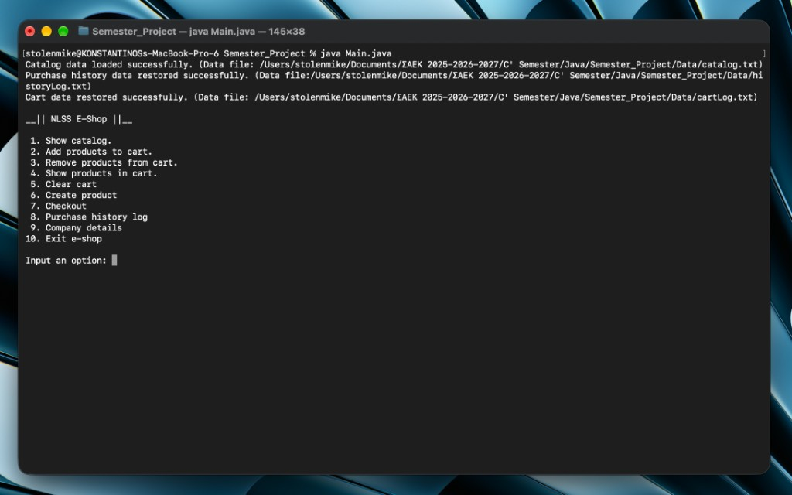
</p>

### 2. Προβολή καταλόγου

Η επιλογή `1` καλεί την συνάρτηση `Catalog.showCatalog(false)`. Τα προϊόντα εμφανίζονται χωρίς κωδικό (ID): όνομα, τιμή, κατηγορία και βάρος.

<p align="center">
  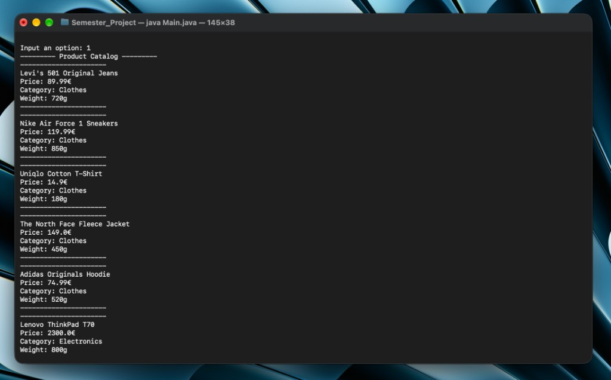
</p>

### 3. Προσθήκη προϊόντων στο καλάθι

Η επιλογή `2` καλέι την συνάρτηση `add_product_to_cart`. Εκείνη καλεί την συνάρτηση `showCartCatalog`, ώστε κάθε προϊόν να φαίνεται με κωδικό και με την ποσότητα που βρίσκεται ήδη στο καλάθι. Το πρόγραμμα ζητάει:

`Input id of the product or type 'Exit' to go back:`

<p align="center">
  
</p>

Στο παράδειγμα δίνεται ο κωδικός `6` όπου αντιστοιχεί στο προϊόν Lenovo ThinkPad T70 και το πρόγραμμα έπειτα ζητά ποσότητα από τον χρήστη:

`Please input quantity:`

<p align="center">
  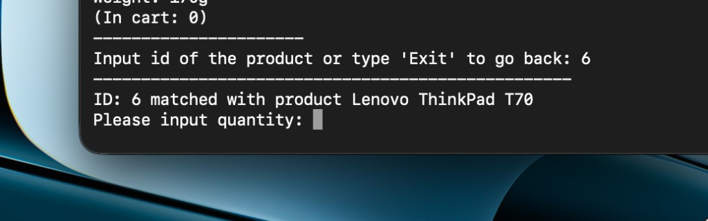
</p>

Με ποσότητα `2`, η συνάρτηση `Cart.addProduct` βάζει το προϊόν δύο φορές στο καλάθι. Η οθόνη δείχνει τιμή μονάδας `2300.0€` και νέο σύνολο `4600.0`.

<p align="center">
  
</p>

### 4. Αφαίρεση προϊόντων από το καλάθι

Η επιλογή `3` καλεί την συνάρτηση `remove_product_from_cart`. Η συνάρτηση `showCartCatalog` καλείται με argument (true), οπότε εμφανίζονται μόνο προϊόντα με ποσότητα τουλάχιστον `1`.

<p align="center">
  
</p>

Το πρόγραμμα ζητάει πάλι κωδικό και αφού τον ταιριάξει με το προϊόν, ζητά την ποσότητα που θα αφαιρεθεί:

`Please input quantity you wish to remove:`

<p align="center">
  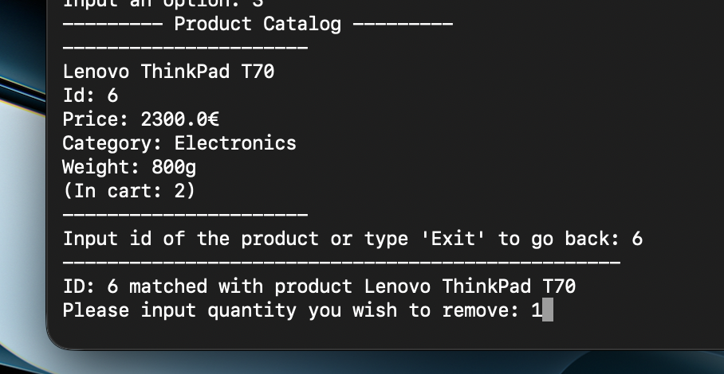
</p>

Αφαιρείται `1` τεμάχιο. Μένει `1`, και το σύνολο γίνεται διαμορφώνεται στα `2300.0€`.

<p align="center">
  
</p>

### 5. Προβολή καλαθιού

Η επιλογή `4` καλεί την συνάρτηση `Cart.showCart`. Το κάθε προϊόν που βρίσκεται στο καλάθι εμφανίζεται στον χρήστη με την ποσότητα του και τυπώνεται το σύνολο.

<p align="center">
  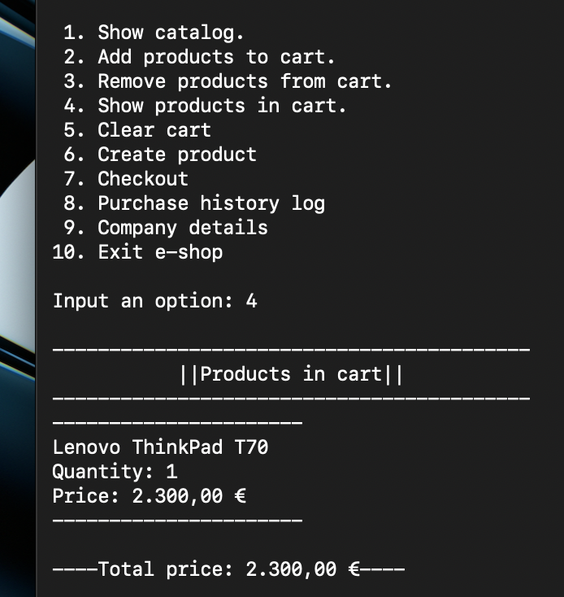
</p>

### 6. Διαγραφή καλαθιού

Η επιλογή `5` καλεί την συνάρτηση `Cart.clearCart`. Το πρόγραμμα ζητάει επιβεβαίωση:

`Type 'Yes' to clear cart.`

Αν η απάντηση είναι `Yes`, ανεξάρτητα από κεφαλαία, η λίστα του καλαθιού καθαρίζει. Κάθε άλλη απάντηση αφήνει το καλάθι ως έχει.

<p align="center">
  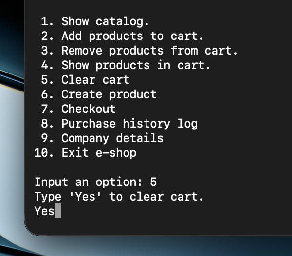
</p>

### 7. Δημιουργία προϊόντος

Η επιλογή `6` καλεί την συνάρτηση `add_product_to_catalog`. Απο τον χρήστη ζητείται: όνομα, κατηγορία, τιμή και βάρος. Τέλος, ζητάτει επιβεβαίωση απο τον χρήστη για την δημιουργεία του προϊόντος.

`Do you wish to proceed? (Yes/No):`

Στο παράδειγμα δημιουργείται το Samsung Galaxy S25 Ultra, κατηγορία Electronics, τιμή `1900`, βάρος `150` γραμμάρια.

<i>Καθώς κάθε νέο προϊόν προστίθεται στο τέλος του καταλόγου, λαμβάνει ως κωδικό (ID) τον κωδικό του προηγούμενου προϊόντος αυξημένο κατά ένα.</i>

<p align="center">
  
</p>

Μετά την καταχώριση, η επιλογή `1` δείχνει το νέο προϊόν στον κατάλογο. Η τιμή εδώ είναι στην απλή μορφή του καταλόγου, `1900.0€`, και το βάρος `150g`.

<p align="center">
  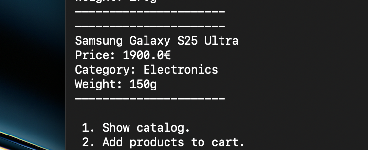
</p>

### 8. Ολοκλήρωση αγοράς

Πριν από αυτό το βήμα, στο καλάθι έχουν προστεθεί ένα Samsung Galaxy S25 Ultra και ένα Lenovo ThinkPad T70. Η επιλογή `7` καλεί την συνάρτηση `Orders.checkout`.

Η συνάρτηση δείχνει το καλάθι, εφαρμόζει έκπτωση `10%` στα ηλεκτρονικά και υπολογίζει μεταφορικά. Το σύνολο πέφτει από `4.200,00 €` σε `3.780,00 €`. Επειδή ξεπερνά τα `1.000 €`, τα μεταφορικά είναι μηδέν. Στο τέλος ρωτάει τον χρήστη αν θέλει να χρησιμοποιήσει εκπτωτικό κωδικό:

`Do you wish to use a promo Code? 'Yes/No':`

<p align="center">
  
</p>

### 9. Κωδικοί εκπτώσεων

Με απάντηση `yes`, το πρόγραμμα ζητάει:

`Please enter a valid promo code (Input 'checkout' if you don't wish to use a code):`

Η λέξη `checkout` συνεχίζει χωρίς κωδικό. Στο παράδειγμα δίνεται ο κωδικός `M3T4M0RF0S1`.

<p align="center">
  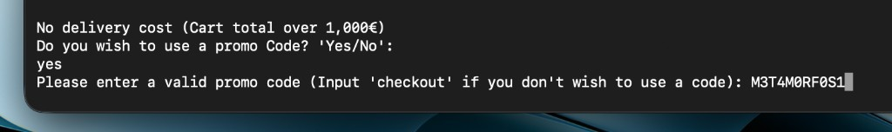
</p>

Η συνάρτηση `checkPromo` αναγνωρίζει τον κωδικό που έχει εισάγει ο χρήστης και επιστρέφει `true` ή `false` αν ο κωδικός είναι σωστός ή λάθος αντοίστιχα. Η συνάρτηση `getPromo` επιστρέφει το ποσοστό της έκπτωσης που σε αυτή την περίπτωση είναι `15%`. Το τερματικό εκτυπώνει `Valid code!`, έκπτωση `-15.0%` και νέο σύνολο `3.286,96 €`. Έπειτα ζητάει οριστική καταχώριση της παραγγελίας:

`Continue with checkout? (Yes/No):`

<p align="center">
  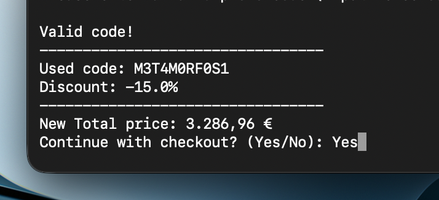
</p>

Με `Yes`, δημιουργείται αντικείμενο `History` με την ημερομηνία της ημέρας και το καλάθι αδειάζει.

### 10. Ιστορικό αγορών

Η επιλογή `8` καλεί την συνάρτηση `Orders.showHistory`. Για κάθε αγορά τυπώνει αριθμό, ημερομηνία, τα προϊόντα όπως ήταν στο καλάθι και το ποσό μετά τις εκπτώσεις.

<p align="center">
  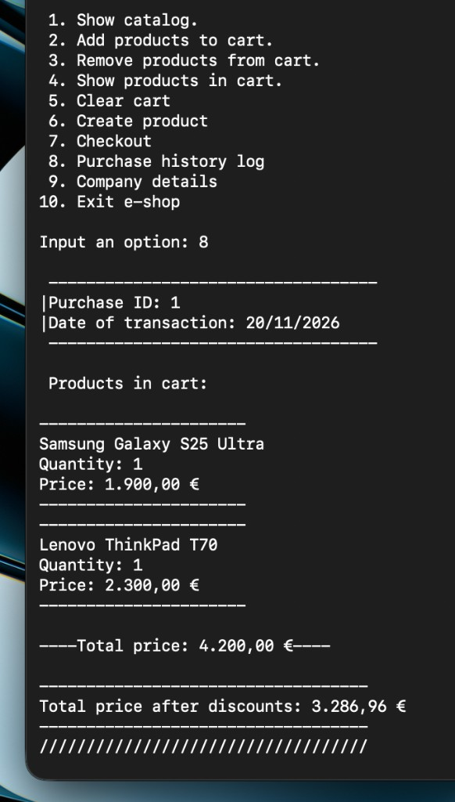
</p>

### 11. Στοιχεία εταιρείας

Η επιλογή `9` τυπώνει την επωνυμία, τη δραστηριότητα, το ΑΦΜ, τη ΔΟΥ, τη διεύθυνση, το τηλέφωνο και το email της εταιρίας.

<p align="center">
  
</p>

### 12. Έξοδος και αποθήκευση

Στην επιλογή `10` το πρόγραμμα πρέπει να αποθηκεύσει τα δεδομένα που χρησιμοποιεί και καλεί, με τη σειρά, τις συναρτήσεις `Cart.saveCart`, `Orders.saveHistory` και `Catalog.saveCatalog`. Το ιστορικό γράφεται δύο φορές: μία στο `Data`, για την επόμενη εκτέλεση, και μία στον φάκελο `Logs`, για ανάγνωση (Μόνο για ιστορικό παραγγελιών).

<p align="center">
  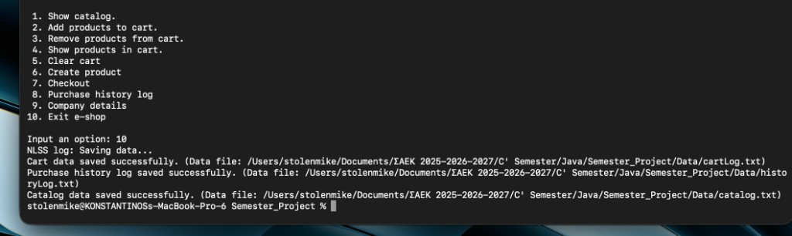
</p>

## Συναρτήσεις

### Main

| Συνάρτηση | Ενέργειες |
| --- | --- |
| `main` | Φτιάχνει κατάλογο, καλάθι και ιστορικό, φορτώνει τα αρχεία δεδομένων και ανοίγει το μενού. |
| `showMenu` | Τυπώνει τις δέκα επιλογές και καλεί την αντίστοιχη συνάρτηση. Στην έξοδο σώζει τα δεδομένα. |
| `add_product_to_cart` | Δείχνει τον κατάλογο με κωδικούς, ζητάει κωδικό και ποσότητα, και προσθέτει στο καλάθι. |
| `remove_product_from_cart` | Δείχνει μόνο όσα είναι στο καλάθι και αφαιρεί την ποσότητα που δίνει ο χρήστης. |
| `add_product_to_catalog` | Ζητάει τα στοιχεία νέου προϊόντος, τα δείχνει και, με επιβεβαίωση, το προσθέτει στον κατάλογο. |

### Catalog και Product

| Συνάρτηση | Ενέργειες |
| --- | --- |
| `Product` (κατασκευαστής) | Αποθηκεύει όνομα, κατηγορία, βάρος και τιμή, και δίνει τον επόμενο κωδικό. |
| `getName`, `getCategory`, `getPrice`, `getWeight`, `getId` | Επιστρέφουν το αντίστοιχο πεδίο. Οι οθόνες του προγράμματος στηρίζονται σε αυτές. |
| `showCatalog` | Τυπώνει όλα τα προϊόντα. Με `false` κρύβει τους κωδικούς. |
| `showCartCatalog` | Τυπώνει κατάλογο μαζί με την ποσότητα στο καλάθι. Στην αφαίρεση παραλείπει όσα δεν είναι στο καλάθι. |
| `addProduct` | Προσθέτει ένα προϊόν στη λίστα του καταλόγου. |
| `getProducts` | Επιστρέφει τη λίστα, ώστε το καλάθι να βρίσκει προϊόν από κωδικό. |
| `restoreCatalog` | Διαβάζει το `Data/catalog.txt` και ξαναδημιουργεί τα προϊόντα. |
| `saveCatalog` | Ξαναγράφει τον κατάλογο στο ίδιο αρχείο. |

### Cart

| Συνάρτηση | Ενέργειες |
| --- | --- |
| `addProduct` | Βρίσκει το προϊόν από τον κωδικό και το προσθέτει τόσες φορές όση η ποσότητα. |
| `removeProduct` | Αφαιρεί έως όσα τεμάχια υπάρχουν ήδη για αυτόν τον κωδικό. |
| `getAmount` | Μετράει πόσα τεμάχια ενός κωδικού υπάρχουν στο καλάθι. |
| `getTotalPrice` | Αθροίζει τις τιμές και στρογγυλοποιεί σε δύο δεκαδικά. |
| `showCart` | Τυπώνει κάθε διαφορετικό προϊόν μία φορά, με ποσότητα, τιμή και σύνολο. |
| `copy` | Αντιγράφει το καλάθι, ώστε το ιστορικό να μην επηρεάζεται από μεταγενέστερες αλλαγές. |
| `clearCart` | Ζητάει `Yes` και, αν το λάβει, αδειάζει το καλάθι. |
| `saveCart` / `restoreCart` | Γράφει και ξαναδιαβάζει τους κωδικούς του καλαθιού. |

### Orders και History

| Συνάρτηση | Ενέργειες |
| --- | --- |
| `checkout` | Δείχνει το καλάθι, εφαρμόζει εκπτώσεις και μεταφορικά, δέχεται κωδικό και, με επιβεβαίωση, καταχωρίζει την αγορά. |
| `getDiscount` | Επιστρέφει το ποσοστό της κατηγορίας. |
| `checkPromo` | Ελέγχει αν ο κωδικός υπάρχει στη λίστα των έγκυρων. |
| `getPromo` | Επιστρέφει το ποσοστό του κωδικού. |
| `showHistory` | Τυπώνει όλες τις αποθηκευμένες αγορές. Αν δεν υπάρχει καμία, τυπώνει `No purchases yet.` |
| `saveHistory` | Γράφει το ιστορικό στο `Data/historyLog.txt` και αναγνώσιμη μορφή στο `Logs/historyLog.txt`. |
| `restoreHistory` | Ξαναφτιάχνει τις παλιές αγορές από το αρχείο δεδομένων. |
| `History` (κατασκευαστής) | Κρατά ημερομηνία, αντίγραφο καλαθιού και τελικό ποσό. |
| `showDate`, `getDate`, `getCart`, `getPurchaseCost` | Δίνουν την ημερομηνία, το καλάθι και το ποσό μιας παλιάς αγοράς. |
| `RestoreOrderHistoryObject` | Μετατρέπει τον κωδικό και την ποσότητα μιας γραμμής ιστορικού από κείμενο σε ακέραιους. |

## Στοιχεία εταιρείας

| | |
| --- | --- |
| Επωνυμία | NEXT LEVEL SHOPPING SOLUTIONS SMPC |
| Δραστηριότητα | Retail Sale of Computers, Electronics & Consumer Goods via Internet (NACE 47.91) |
| ΑΦΜ | EL090000045 |
| ΔΟΥ | KEFODE Attikis (Attica Tax Operations Center) |
| Διεύθυνση | 328 Vouliagmenis Avenue, Agios Dimitrios, 173 43, Athens, Greece |
| Τηλέφωνο | +30 210 000 0000 |
| Email | info@nlss.gr |

## Άδεια Χρήσης & Πνευματικά Δικαιώματα

Copyright © 2026 Κωνσταντίνος Τσούτας (`KostasTsoutas`). Με επιφύλαξη παντός νομίμου δικαιώματος.

Το παρόν έργο εκπονήθηκε στο πλαίσιο εξαμηνιαίας εργασίας με προδιαγραφές παραγωγικού περιβάλλοντος ως έργο αναφοράς.  
Διατίθεται υπό τους όρους της άδειας ελεύθερου λογισμικού **GNU General Public License v3.0 (GPL-3.0)**, δείτε το αρχείο [LICENSE](LICENSE) για τις πλήρεις λεπτομέρειες.

## License & Copyright

Copyright © 2026 Kostas Tsoutas (`KostasTsoutas`). All rights reserved.

This project was originally developed as a semester assignment and designed to production-ready standards as a portfolio showcase.  
It is licensed under the **GNU General Public License v3.0 (GPL-3.0)**, see the [LICENSE](LICENSE) file for details.
